# Docker Sandboxes for Paseo

A Paseo plugin that runs each workspace's Claude Code and Codex agents inside its own [Docker Sandboxes](https://docs.docker.com/ai/sandboxes/) microVM. Agents work on the same files at the same paths, but every container, network, port and test browser they start lives in that workspace's VM. Workspaces stop colliding: a Postgres on port 5432 in one does not clash with another, and container churn in one no longer breaks browser tests in another.

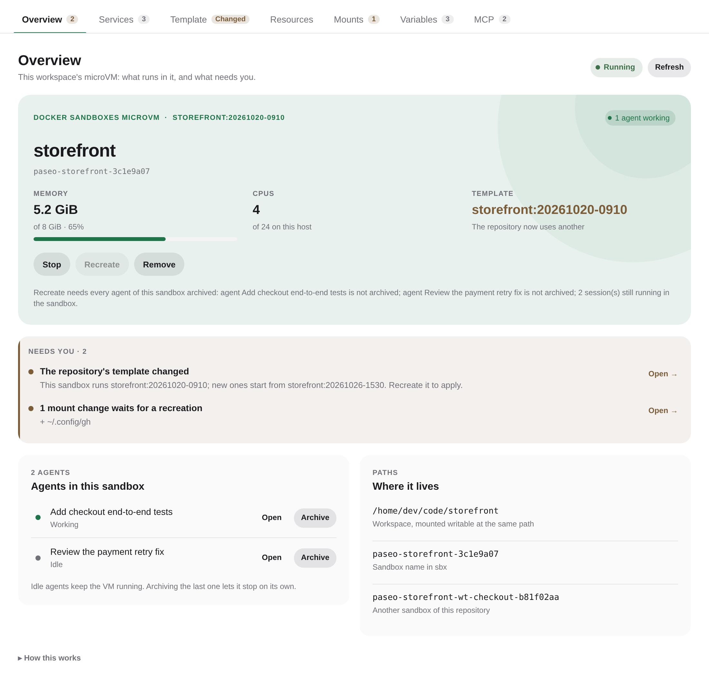

Screenshots show made-up projects, agents and paths.

## What it shows

### The workspace's Sandbox dashboard

A panel beside each workspace, opened from its **+** menu, in tabs. Each tab's badge counts what it holds, or says what changed.

- **Overview**: the sandbox's status, memory in use against its limit, CPUs and template, with **Stop**, **Recreate** and **Remove**. Below is what needs you, each item opening the tab that fixes it: a template, resources or mounts that changed since the sandbox was created, a GSD Path member without a checkout, a variable without a value, a port that could not be published, a failed operation. Then the agents running in the sandbox, with **Open** and **Archive**.
- **Services**: the ports listening in the VM and the ones published on the host, with the host address of each. Publish a port on `127.0.0.1` or every host address, on a port you pick or a free one, and keep it published for every sandbox of the repository.
- **Template**: which template the repository's sandboxes start from, with **Remove** on old versions nothing uses, and a guided preparation: a shell in a clean sandbox to install your tools, then save it as a template.
- **Resources**: memory and CPUs for the repository's sandboxes.
- **Mounts**: every host folder the sandbox sees, where it comes from and whether it waits for a recreation; the repository's own mounts, added one at a time; and the GSD Path members.
- **Variables**: the host variables forwarded to sessions, whether each has a value, and the repository's own.
- **MCP**: which MCP servers the repository's sandboxes load, each on for all sandboxes or set for this repository, and whether it is loaded, loading, waiting for the sandbox to start, or failed.

| Services | Template |
| --- | --- |
| 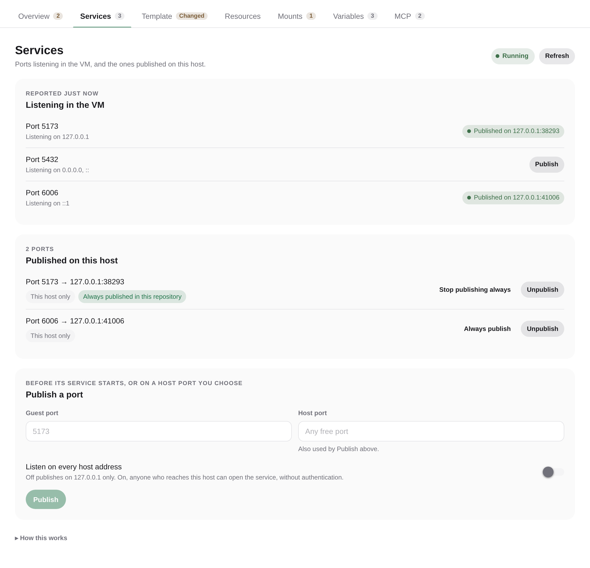 | 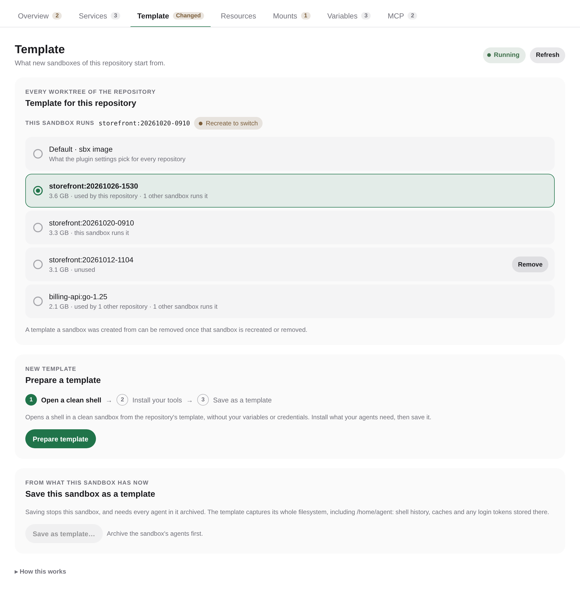 |
| **Mounts** | **On a phone, dark theme** |
| 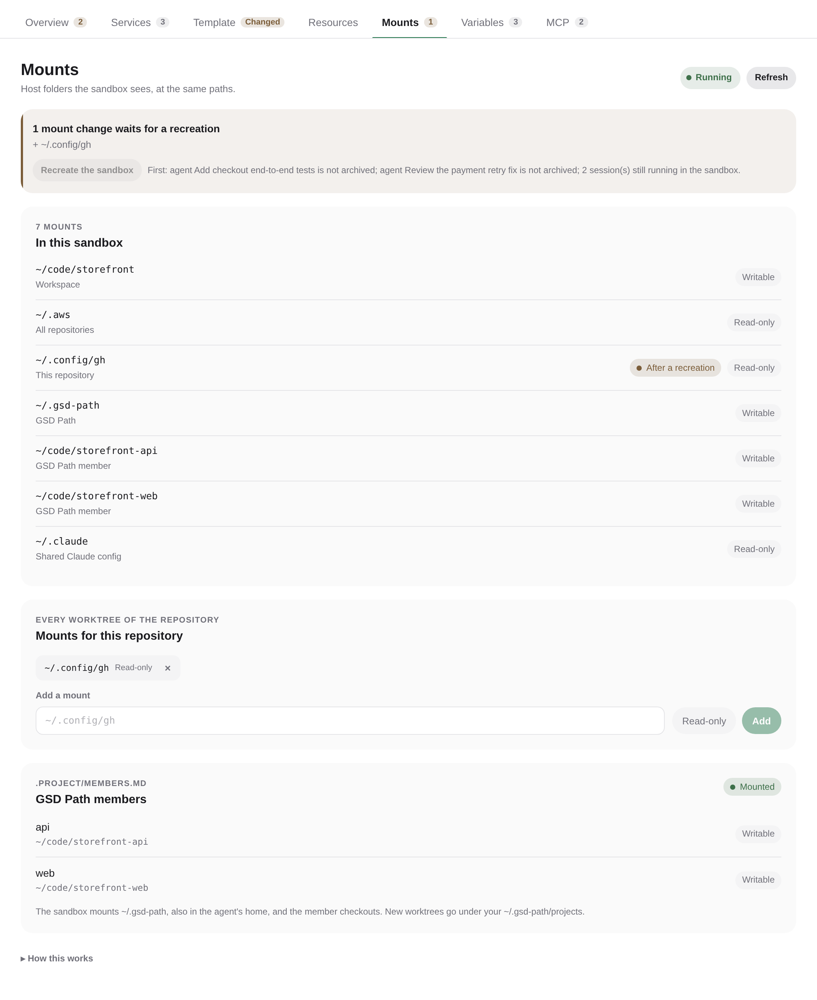 | 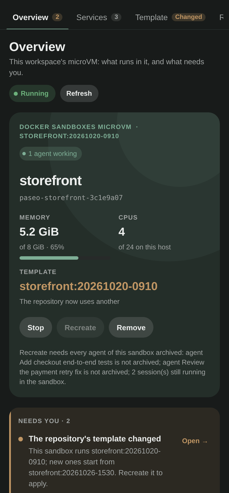 |

### The Docker Sandboxes screen

Opened from the sidebar, for every sandbox at once.

- **Overview**: the memory the VMs hold against the host's, with available RAM, swap and memory pressure, and an alert past the thresholds you set. Then what needs you and the agents that keep each VM running, biggest first, with **Archive**.
- **Sandboxes**: every VM the plugin created, grouped into workspaces, template preparations and agent catalogs, with **Stop** and **Remove**.
- **Agents**: Claude and Codex, each with its CLI version, catalog sandbox, provider and login, the command that stores its login, and **Configure** or **Update**.
- **Templates**: the saved templates, their size, the repositories and sandboxes that use them, and **Remove** for the ones nothing uses.
- **MCP servers**: the remote MCP servers agents reach through sbx's gateway, each with its sign-in status, an **On for all sandboxes** switch and how many sandboxes have it loaded. **Add a server** takes its address and an OAuth sign-in or an API key; **Sign in** shows the provider's page and takes back the address the browser ends on, for a browser on another device.

| Overview | Sandboxes |
| --- | --- |
| 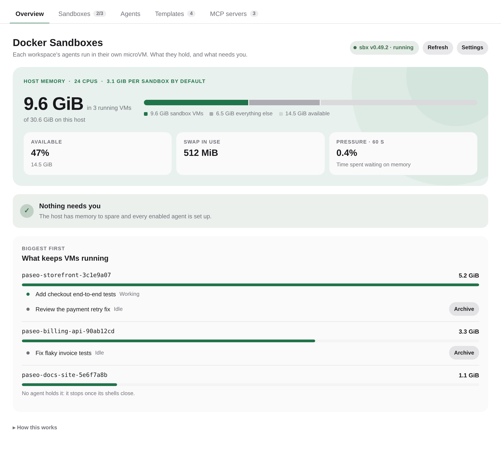 | 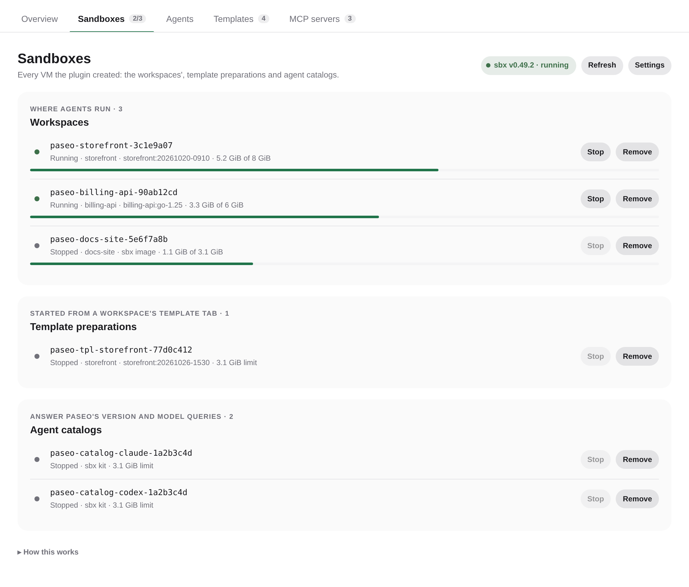 |
| **Agents** | **Templates** |
| 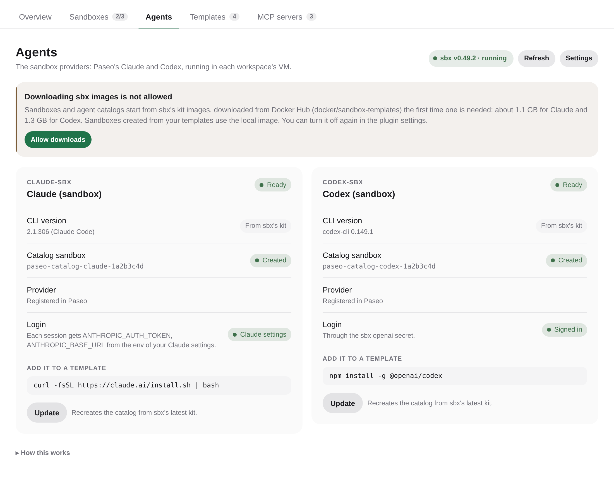 | 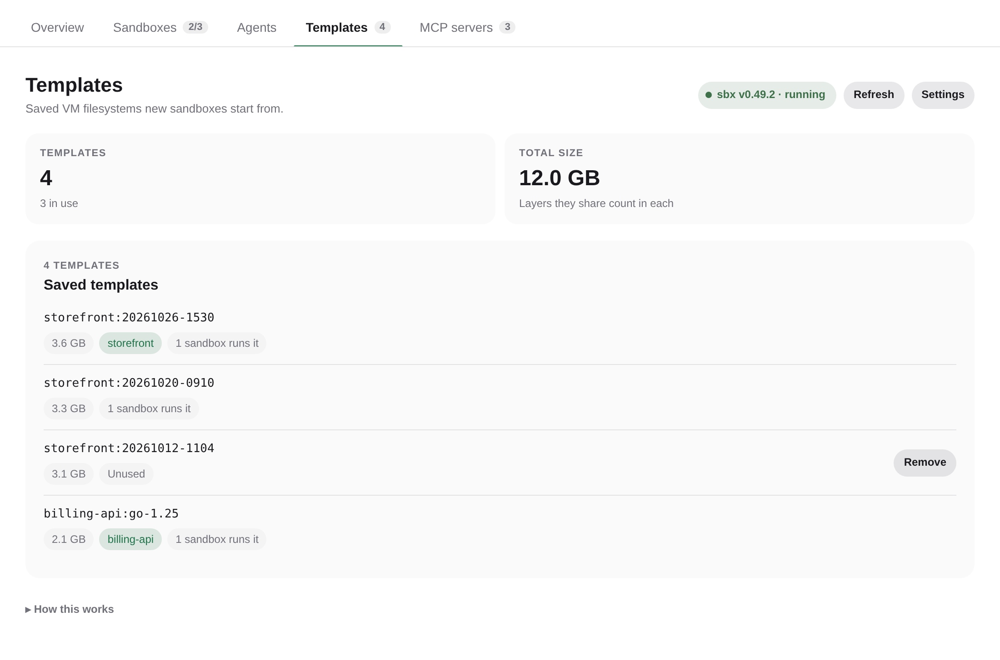 |
| **MCP servers** | **Signing in from another device** |
| 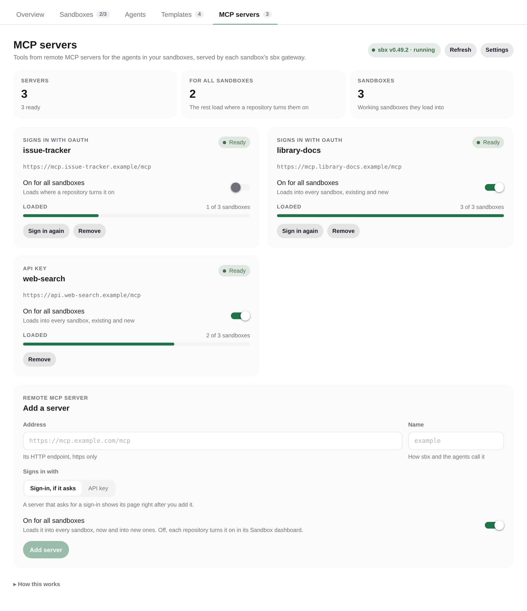 | 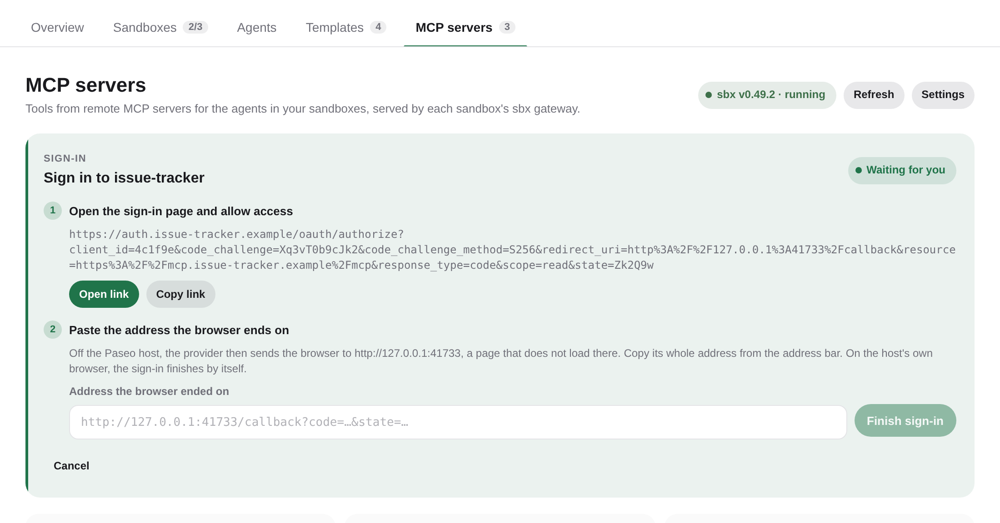 |

Each tab folds the notes on how to read it under **How this works**. The screens follow Paseo's light and dark themes and fit a phone.

## Requirements

- Linux host. Developed on Ubuntu 26.04 with `sbx` 0.49.
- `sbx` installed and signed in (`sbx login`). The login token lives in the OS keyring: on a headless host, use a keyring without a password, or `sbx` stops answering (HTTP 503) once the keyring locks.
- `python3` in the sandbox image (sbx's agent images have it). The agents' CLIs come from the sandbox's template, so none needs to be installed on the host.
- Paseo 0.13.0 or later.

## Install

```bash
paseo plugin install npm:@drungrin/paseo-sbx
```

Releases are published on npm. To follow `main`, install from GitHub with `paseo plugin install github:drungrin/paseo-sbx`; Paseo supplies the modules the plugin imports, so it needs no build step. To run a checkout you change, install its directory: `paseo plugin install /path/to/paseo-sbx`.

Then:

1. Open **Docker Sandboxes** in the sidebar and, in its **Agents** tab, press **Configure** for each agent. It registers the agent's provider (`claude-sbx`, `codex-sbx`) and creates its catalog sandbox. The first time, it asks you to allow downloading sbx's kit image from Docker Hub. Codex is off until you turn it on under **Agents** in the plugin settings.
2. Store each agent's login once, then press **Update**. Codex signs in with `XDG_STATE_HOME=~/.local/state/paseo-sbx/sbx sbx secret set openai --oauth`. Claude signs in with the `env` of your Claude settings (a key or a gateway); without a login there, store the `anthropic` secret the same way.
3. Pick **Claude (sandbox)** or **Codex (sandbox)** when you create an agent, or turn on **Run new Claude agents in sandboxes** in the plugin settings.

[OVERVIEW.md](OVERVIEW.md) explains every setting and the plugin's limits.

## How it works

| Piece | Where | Role |
| --- | --- | --- |
| Plugin server | Paseo daemon | Settings, the `agent.session_open` hook that builds each session's sandbox spec, the optional `agent.create` hook that routes `claude` to `claude-sbx`, RPCs for the UI |
| Launchers (`paseo-sbx-claude`, `paseo-sbx-codex`) | Host, the registered provider commands | Run the wrapper with the daemon's own Node (in Node mode when the daemon runs inside Electron), naming the agent |
| Wrapper (`paseo-sbx-claude.cjs`) | Host | Creates the sandbox, reconciles its network policy and MCP servers, starts the loopback relay, runs the agent's CLI from the template inside the VM; sends runs without a session to the agent's catalog sandbox |
| Shell launcher (`paseo-sbx-shell`) | Host, the Sandbox terminal profile's command | Runs the wrapper's shell mode: ensures the workspace's sandbox from its recorded spec, then a shell in it with the sessions' Claude config and login |
| `guest-supervisor.py` | Sandbox | Adds sbx's MCP gateway to Claude's MCP config, feeds Claude's stdin and stops its process tree when the session ends |
| `loopback-forward.py` | Sandbox | Relays guest `127.0.0.1:<port>` to the host's loopback |
| `guest-agent.py` | Sandbox | Runs the relays of published ports and reports the guest's listening ports |
| `seed-claude-settings.py` | Sandbox | Starts a sandbox's own Claude settings from the kit's, once |
| `paseo-sbx-shellrc` | Sandbox | The Sandbox terminal's bash startup: a login shell's, plus `claude` with sbx's MCP gateway |

The server bundle cannot read files from the plugin directory, so the plugin writes the launcher, the wrapper and the guest helpers to `~/.local/state/paseo-sbx/bin` on startup and registers the provider with `config.patch`, keeping any label, env or model fields you customized on that entry.

State lives under `~/.local/state/paseo-sbx` (respects `XDG_STATE_HOME`):

- `sbx/`: the Paseo-only `sbx` instance (`XDG_STATE_HOME` for `sbx`). Inspect it with `XDG_STATE_HOME=~/.local/state/paseo-sbx/sbx sbx ls`.
- `claude/<sandbox>/`: per-sandbox Claude config directories, with each sandbox's own settings and the copies of shared files (recorded in `.paseo-sbx/shared-copies.json`). Paseo reads transcripts here for history and rewind.
- `catalog/<agent>.json` and `catalog/<agent>/`: each agent's catalog sandbox (name, the kit's CLI version, what its runs need) and its workspace.
- `homes/<agent>/`: agents' homes shared by every sandbox and the catalog, at the same path inside them (Codex's `CODEX_HOME`).
- `sandboxes/<sandbox>.json`: how each sandbox was created (repository, template and its image ID, memory, CPUs, Docker disk, mounts), the network rules applied to it, and the MCP servers the plugin loaded into it or still has to unload. Removing a rule from the settings revokes it on the next launch.
- `locks/`: per-sandbox locks, the leases of running sessions, and the marker of a recreation in progress.
- `run/`: per-session env files, private to your user and never mounted.
- `workspaces/<workspace>.json`: the spec last built for each workspace, without its variables, which the Sandbox terminal reads.
- `agents/<agent>.json`: the sandbox each agent first opened in. Resume, refresh and history reuse it, so changing the isolation mode does not move existing agents or their transcripts.

### Design decisions

- **Fail closed, and nothing on the host.** The wrapper refuses to start a session without the spec the plugin injects: with the plugin disabled, sandboxed agents fail with a clear error. Paseo runs some things outside sessions (model catalog, diagnostics, Codex's archive and unarchive, history of archived agents); those go to the agent's catalog sandbox, never to the host. A session is told apart by the `PASEO_AGENT_ID` Paseo adds to it, unless the daemon itself was started with that value (a daemon launched from an agent session).
- **Downloads need your consent.** Catalogs, and sandboxes or template preparations without a template, can download sbx's kit image from Docker Hub. The server and the wrapper refuse them until the `allowImageDownloads` setting is on, and the app asks before it starts one, so declining starts nothing. A template's sandbox is created with `--pull never` and needs no consent.
- **One launcher per agent.** Some of Paseo's version probes run only the provider command with `--version`, dropping any argument, so the agent cannot be an argument: each agent's launcher names it in the environment.
- **CLIs from the template.** Sessions run the CLI found on the template's `PATH`; a template built for one agent's kit lacks the others, so a workspace with both Claude and Codex agents needs a template with both. sbx applies a kit to a template's image only if the kit built it: sandboxes are created with the kit the template's flavor names, or the starting agent's without a template.
- **The catalog answers without a session.** Each agent's catalog sandbox is created from sbx's kit, without your workspace, and records the CLI's version. Paseo asks for the version first and gives Claude's model probe 5 s, so the version comes from the record while the catalog VM starts. Claude's settings reach the catalog without their `env` (a gateway's token): the env goes to each run through its private env file.
- **Login through sbx's secrets.** The sbx proxy swaps a `proxy-managed` marker for the stored secret, in any sandbox and for a secret stored after the sandbox was created. A kit writes its markers when created: the catalog's are copied into the agent's shared home (Codex's `auth.json`), so API keys and OAuth work without the plugin knowing their format. Update after storing a secret. Claude keeps signing in on its own: every session gets the `env` of your Claude settings (a gateway, a key, Bedrock, Vertex) through its private env file, and an `apiKeyHelper` counts only when you share `settings.json`. The `anthropic` secret applies only when nothing else does.
- **Each sandbox owns its Claude settings.** A file mount keeps the inode it started with. Claude saves `settings.json` by renaming a new file over it, so a mounted `settings.json` became unreadable in every sandbox created before the save, until the VM restarted, taking the login with it. Shared files are copied at every session instead, read-only, and your `settings.json` is no longer shared by default: a sandbox's starts as the kit's and is Claude's to change there, and only its `env` (your login) comes from yours, read at every launch. Settings version 3 drops `settings.json` from a list still at the old default.
- **Codex's home is shared.** Codex's threads must be reachable from the catalog, which runs its archive, unarchive and history; one `CODEX_HOME` for every sandbox works like `~/.codex` on a host with several sessions. Sandboxes created before it have no mount for it: Codex there asks for a Recreate. Prompt images Codex gets as host temp files are copied into the sandbox's config dir on their way in.
- **Credentials stay out of sbx processes.** Names that look like credentials in the daemon's environment are dropped from every `sbx` call, so the sandbox daemon never inherits them. Claude's shared folders are mounted one by one, never the config dir with its credentials; shared files are copied.
- **Teardown inside the guest.** The `sbx exec` client can exit while Claude is still inside a tool call, and the daemon tree-kills the wrapper and anything it spawns during shutdown. The guest supervisor stops Claude's process tree once its stdin reaches EOF, which happens however the session ends on the host.
- **Paseo-only `sbx`.** Paseo's sandboxes live in their own `sbx` instance, started by the daemon on demand. Restarting Paseo stops them; your own sandboxes are unaffected.
- **Secrets stay out of sbx processes.** Forwarded values reach the guest through a 0600 file in `run/`, passed with `sbx exec --env-file` and deleted when the session ends (files of sessions that were killed go at the next launch). No sbx client runs with them in its environment, so the sandbox daemon never inherits them, whichever call starts it. A value with a newline cannot go in that file and falls back to the client environment. Variables the `sbx` client reads itself (`PATH`, `HOME`, `XDG_*`, `SBX_*`, `DOCKER_*`, ...) are never forwarded.
- **Settings per repository.** Templates, memory, CPUs, mounts and variables are keyed by the repository's git common dir, so every worktree of a repo shares them while each gets its own sandbox. A sandbox keeps the repository it was created for. Version 1 per-sandbox overrides that could not move to one repository are listed in the Docker Sandboxes screen to reassign.
- **Templates.** A template is a saved sandbox filesystem in the Paseo instance (`sbx template save`). It does not include the images of the VM's own Docker. sbx saves only a stopped sandbox, so the plugin stops it first and refuses while sessions run in it. Prepare one in a clean sandbox, without your variables or credentials: saving a working sandbox captures `/home/agent`, login tokens included.
- **Recreate needs archived agents.** The plugin API can neither close nor reopen an agent's runtime, and a resident agent can start a turn at any time, so the plugin recreates a sandbox only when every agent bound to it is archived and no session runs. The server holds the sandbox lock for the whole operation and marks it so new launches fail fast.
- **Home mounts are bind mounts.** A mount under your home is bind-mounted at the same place under the guest's home at every launch, with the sandbox user's sudo, since binds do not survive a VM restart. A symlink would need no root, but GSD Path refuses symlinked runtime storage.
- **Docker disk per sandbox.** sbx sizes `/var/lib/docker` from `sandbox.disk.dockerVolume`, a setting shared by every sbx instance of your user. The plugin passes `DOCKER_SANDBOXES_DOCKER_SIZE` to `sbx create` instead, so your own sandboxes keep sbx's size. The volume is sparse on the host.
- **Memory without entering the VM.** Each VM's resident memory is read from its `containerd-shim-nerdbox-v1` process, matched to the sandbox through the `config.json` in the process's working directory. Any `sbx exec` would postpone the auto-stop, and polling through it would keep VMs running.
- **Every publication goes through a relay.** sbx publishes only what listens on the VM's external interface, and dev servers often listen on loopback. The guest agent listens on a port of its own (41000-41999) and forwards to the service's port on the guest loopback, which also reaches services listening on `0.0.0.0`. Its own port keeps it from blocking the service if the service later binds every address. The agent writes the listening ports to the sandbox's Claude config dir, the one mount both sides can write, so the panel lists them without `sbx exec`; the host reads that file as untrusted input. Publications are kept per sandbox and reconciled at every launch; a repository's auto-published ports are added there. Each gets an explicit host port, picked when you leave it empty: sbx 0.49 restores publications at every start and keeps an ephemeral one in a form `--unpublish` cannot remove, so it would come back after each restart. An explicit port is removed for good and keeps the URL stable.
- **MCP servers through sbx's gateway.** Every sandbox has an MCP gateway on the host side of the VM; sbx keeps the servers' tokens and API keys and adds them to the gateway's requests. Only remote servers: a local one would run on the host, outside every sandbox. sbx registers the gateway in its kit's own Claude config, which plugin sessions do not use, so the guest supervisor merges the same entry into the MCP config Paseo passes. sbx has no command that lists what a local sandbox loaded; the plugin reads sbx's record of it and says when that record changes shape instead of guessing. Unloading needs a running VM, so a server turned off while a sandbox is stopped is unloaded at its next launch. Off means the plugin does not load it: agents can still add any registered server with the gateway's `mcp-add` tool.
- **Sign-ins on any device.** Without a display, `sbx mcp auth` prints the provider's page and waits on a loopback listener for the redirect. A browser on another device lands on an address only this host can open; you paste it back and the plugin delivers it to sbx. It accepts only an address with that sign-in's loopback port, path and `state`, so a paste never makes it request anything else, and a stale one cannot end the sign-in (sbx aborts on a wrong `state`).
- **A terminal profile for the shell.** A plugin cannot add actions to the workspace's **+** menu, only panels, and a panel opens a plugin tab. **Sandbox terminal** is a terminal profile instead, added once to Paseo's config the first time a Docker Sandboxes view opens (a stored list replaces Paseo's defaults, so they are stored with it); one you remove stays removed. Its launcher cannot ask the plugin which sandbox a workspace has, so the server records each workspace's spec, without the variables, whenever it builds one: the dashboard, an agent session, or **Open sandbox terminal** in the command center, which records it before opening the terminal. The shell sets the tab's title, since Paseo shows a terminal's command line otherwise.
- **No stop on archive.** Archiving an agent closes its runtime, and the VM stops 30 seconds after its last session. What keeps VMs running is agents that are not archived; the plugin API cannot close their runtimes, so the Docker Sandboxes screen lists them with an Archive action.
- **Invalid settings fail instead of defaulting.** Falling back to defaults could silently turn routing off or reopen the network policy. The plugin keeps the last valid settings it read; without any, `claude-sbx` sessions and routed agent creation fail with a message pointing to the settings screen.

### What reaches the guest environment

Automatically: variables starting with `ANTHROPIC_`, `CLAUDE_`, `PASEO_`, `MCP_` or `DISABLE_`, plus `API_TIMEOUT_MS`, `MAX_THINKING_TOKENS`, `LANG`, `TZ` and `NO_BROWSER`, from the daemon environment. Paseo's MCP server is relayed from the daemon's port in its config, since Codex gets the MCP URL inside its protocol. Anything else your tools need (license keys, cloud credentials) goes under **Forwarded variables**, with values in the variables file. The plugin adds `GIT_CONFIG_*` entries for **GitHub over HTTPS** after any you forward, and, in a repository using GSD Path, `GSD_PATH_WORKTREE_ROOT` at the host's `~/.gsd-path/projects`: GSD Path would otherwise register worktrees created in the guest under the guest's home, a path the host's git cannot reach. Importing a host Claude session into `claude-sbx` copies that project's transcripts into the sandbox's config directory first.

## Working inside a sandbox

- **Sandbox terminal** in the workspace's **+** menu, or **Open sandbox terminal** in the command center, opens a shell in the VM, in the workspace, with the sessions' Claude config and login.
- `PASEO_SBX_SANDBOX` is set to the sandbox name, so scripts can detect they run in a sandbox.
- k3d needs two flags inside the VM, which has no `/dev/kmsg`:
  `--volume "/dev/null:/dev/kmsg@server:*" --k3s-arg "--kube-proxy-arg=conntrack-max-per-core=0@server:*"`.
- Build outputs record absolute cache paths. When the same checkout is built on the host and in a sandbox (or in two sandboxes), restore before testing: for .NET, `dotnet test --no-build` can otherwise pass while running no tests.
- A .NET SDK mounted read-only needs `DOTNET_SKIP_WORKLOAD_INTEGRITY_CHECK=1` in a fresh sandbox.

## Troubleshooting

- **`claude-sbx` agents fail with "missing PASEO_SBX_SPEC"**: the plugin is disabled or failed to load (`paseo plugin ls`).
- **The Docker Sandboxes screen shows the sbx daemon as not running**: run `XDG_STATE_HOME=~/.local/state/paseo-sbx/sbx sbx daemon status`. A locked keyring is the usual cause.
- **Agents cannot reach a host service**: add its port under **Extra host ports**. Inside the sandbox, `127.0.0.1:<port>` is relayed to the host.
- **A build dies with exit code 137**: the VM ran out of memory. Give the repository more memory or fewer CPUs in the **Resources** tab of its **Sandbox dashboard**, then recreate the sandbox.
- **Tests fail with "No space left on device"** from a database in the VM's Docker: raise **Docker disk per sandbox**, then recreate the sandbox.
- **A published port shows "not published"**: its host port was taken when the sandbox started. Pick another fixed port, or leave it empty.
- **An MCP server's tools do not show in an agent**: check its status in **MCP servers** (until you sign in, a server offers only its sign-in tool) and its switch in the workspace's **MCP** tab. Sessions started before this version reach no gateway: start them again.
- **Wrapper logs** appear in the daemon log as Claude Agent SDK stderr lines prefixed with `[paseo-sbx]`.

## Development

```bash
npm install
npm run typecheck
npm test
```

The wrapper tests run the real wrapper against a fake `sbx` that keeps sandboxes in a JSON file and runs `exec` commands locally, with a VM-like environment and its own stdin pipe.
